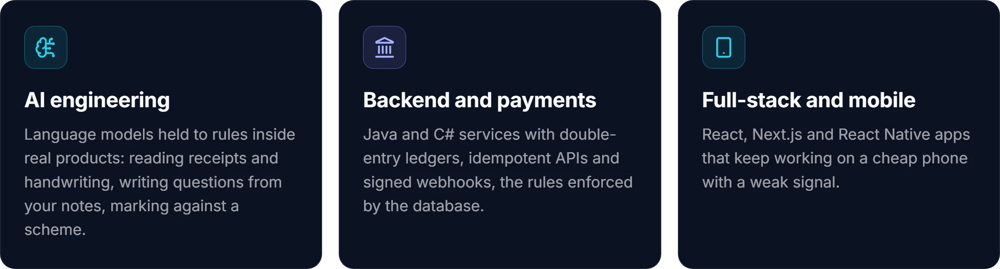
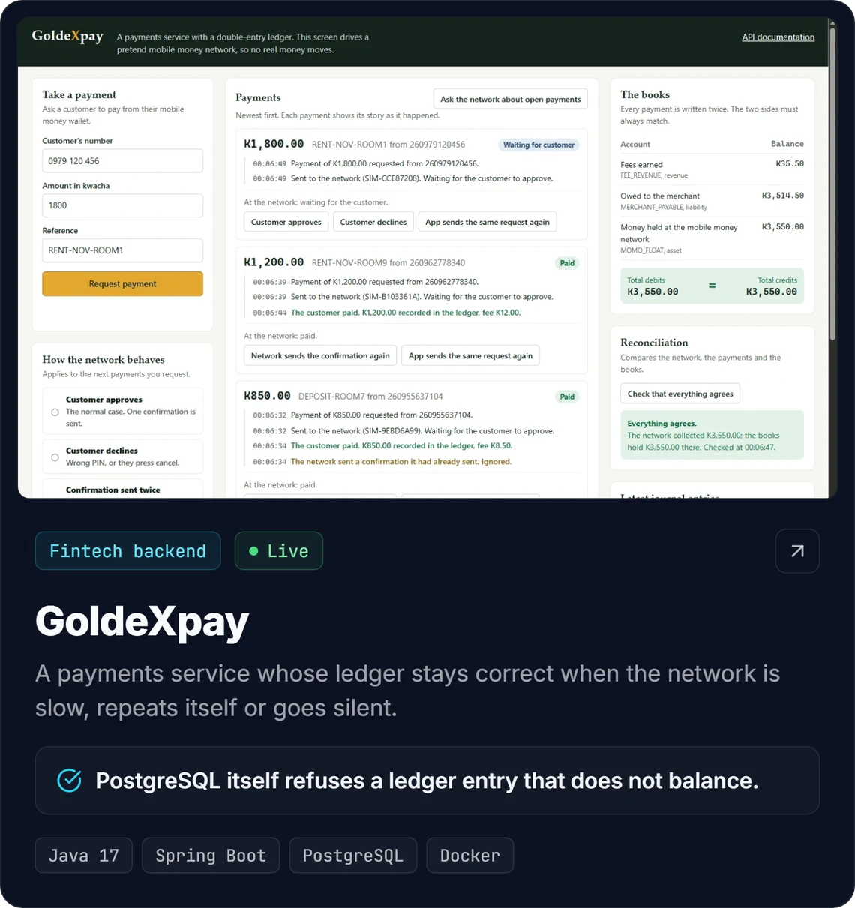
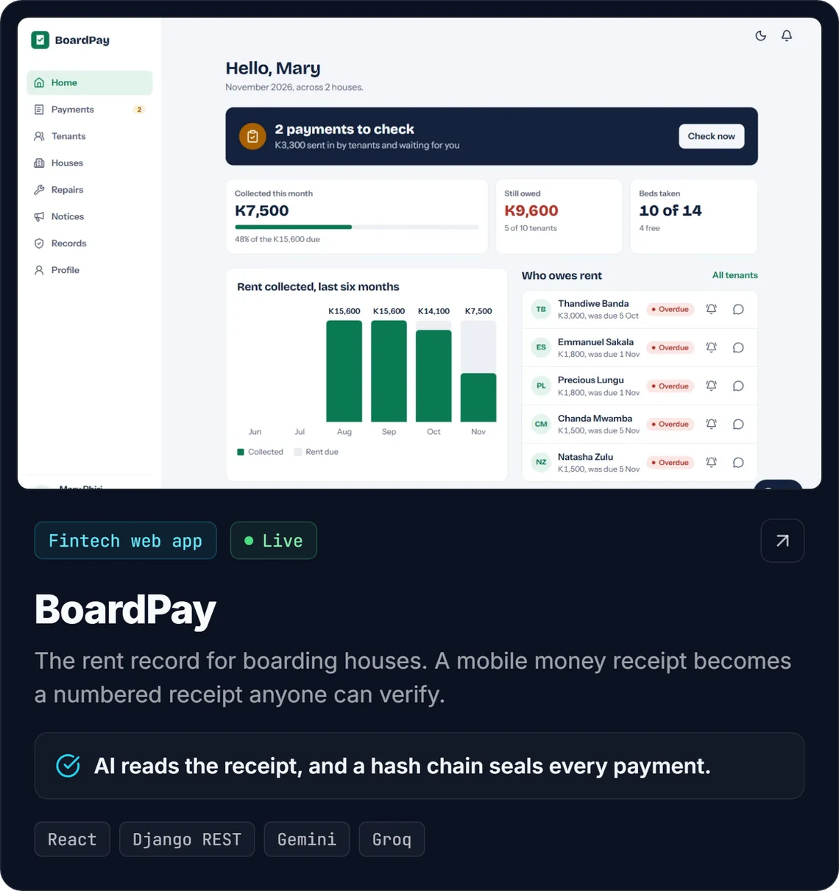
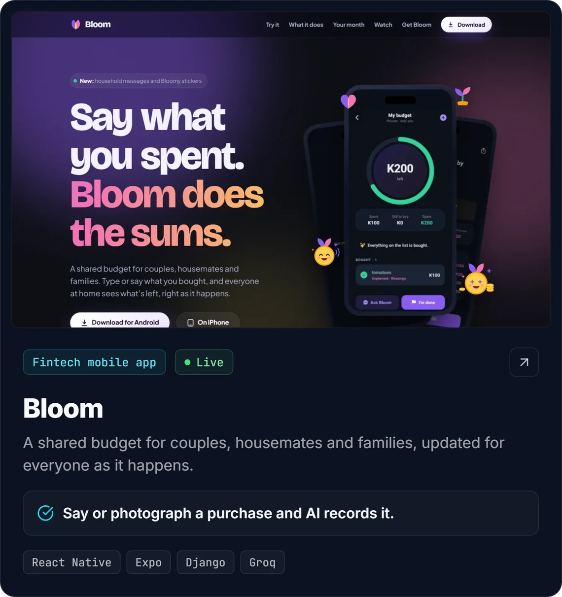
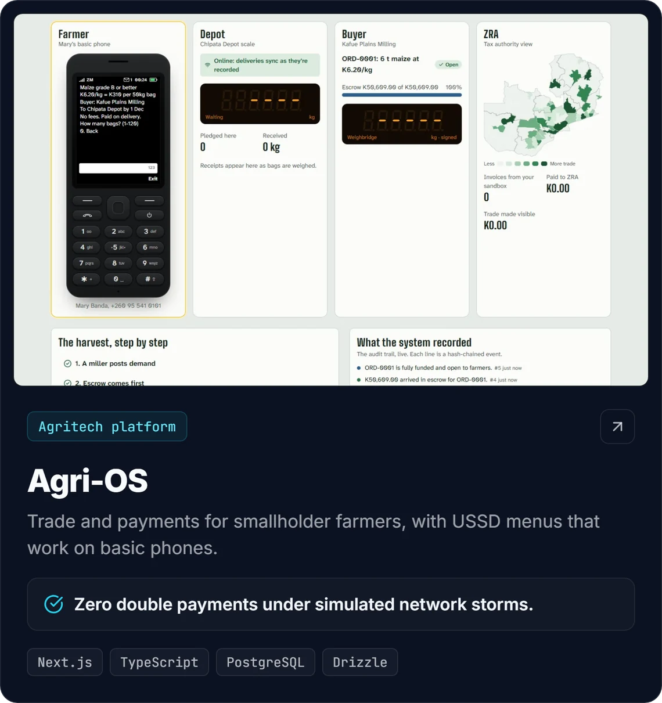
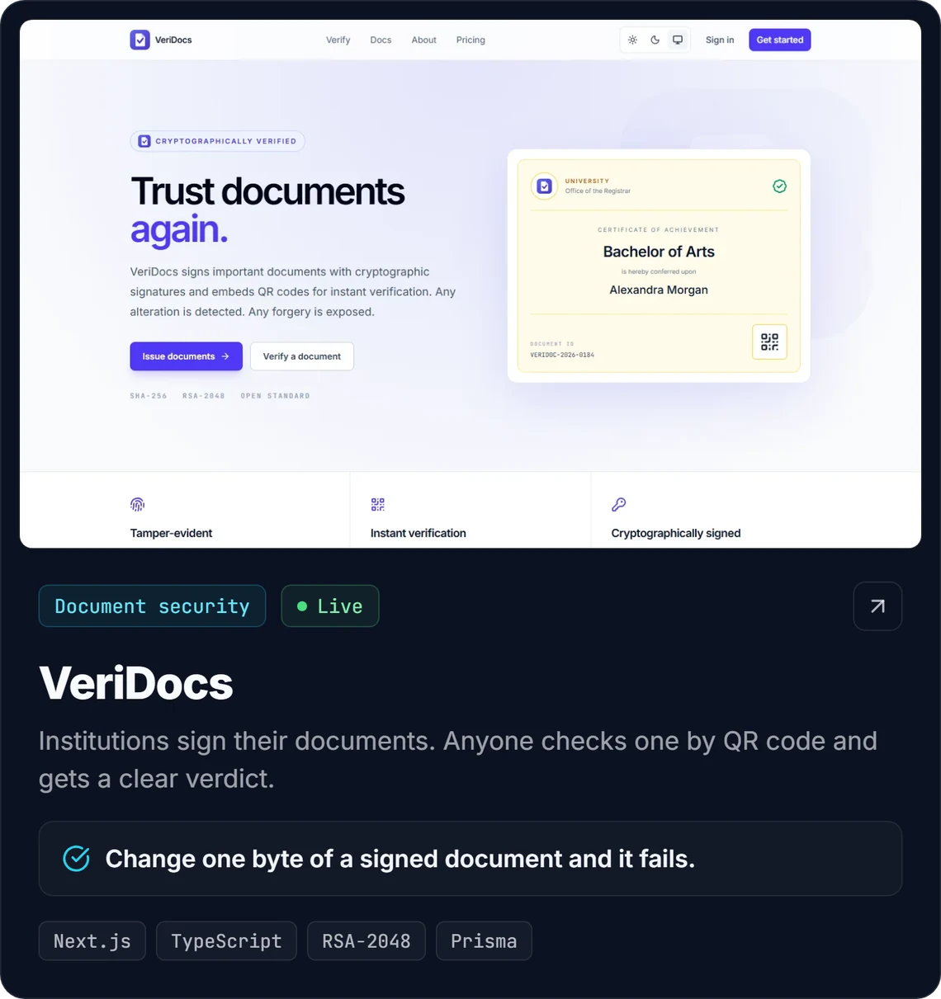
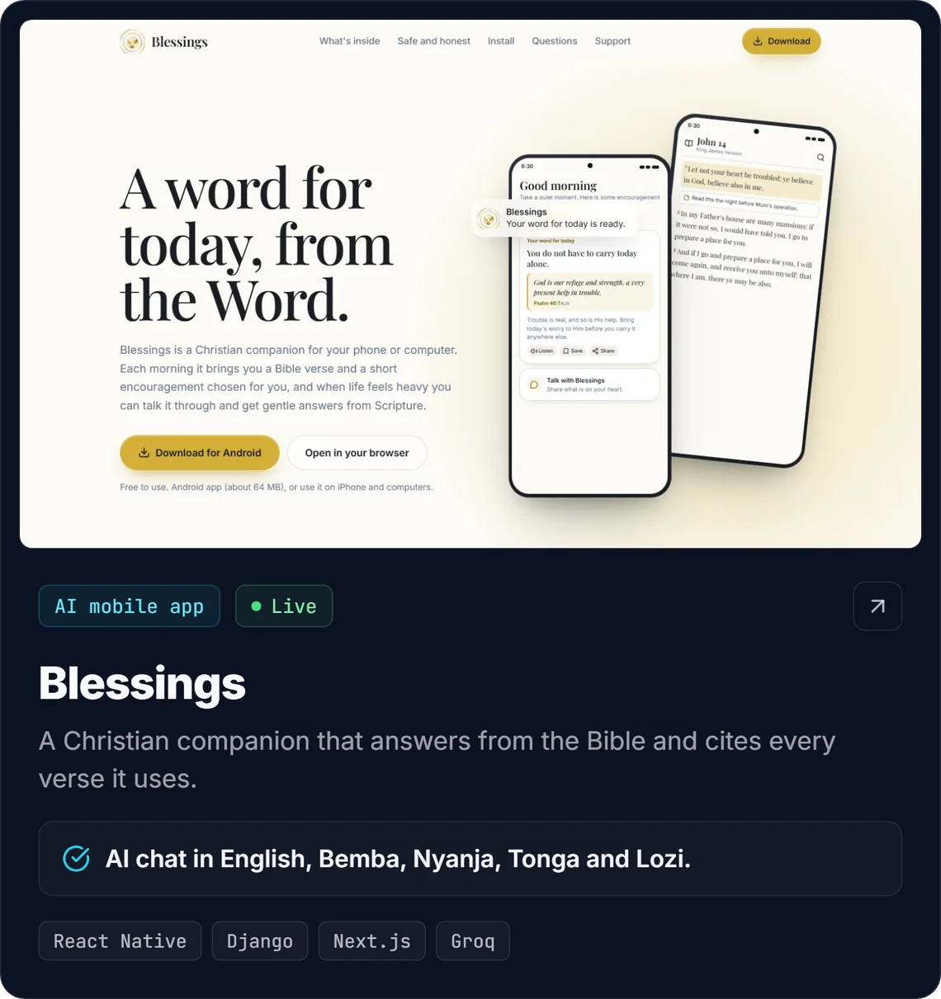
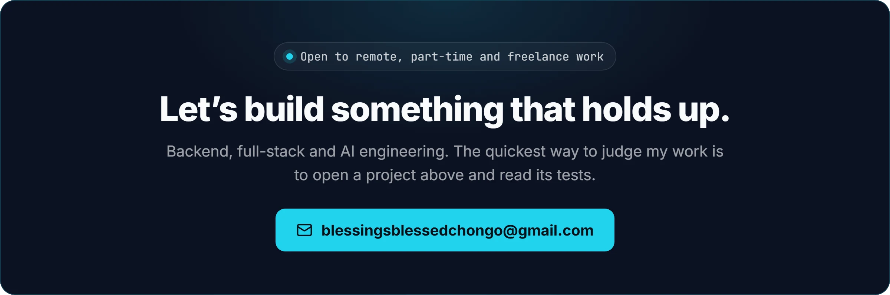

&nbsp;
&nbsp;
&nbsp;

## What I do

## Featured work

  
  
 
  
  
 
  
  

  Source code: <a href="https://github.com/BlessingsBlessedChongo/GoldeXpay">GoldeXpay</a> · <a href="https://github.com/BlessingsBlessedChongo/BoardPay">BoardPay</a> · <a href="https://github.com/BlessingsBlessedChongo/Agri-OS">Agri-OS</a> · <a href="https://github.com/BlessingsBlessedChongo/veridocs">VeriDocs</a> · <a href="https://github.com/BlessingsBlessedChongo/NeuroSynapse">NeuroSynapse</a> (final-year project: a network that finds and fixes its own faults)

## Tools I use

  

  Also: LLM integration (Gemini, Groq) · PyTorch · scikit-learn · React Native (Expo) · Vue.js · Tailwind CSS · Prisma · Drizzle · Flyway · Vitest · Playwright · JUnit

## Experience and community

